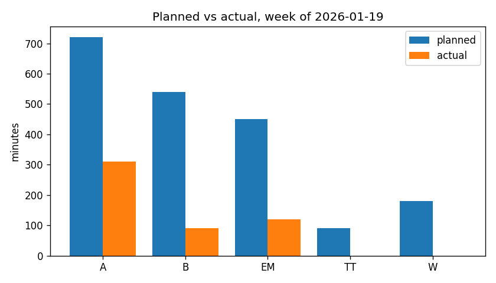
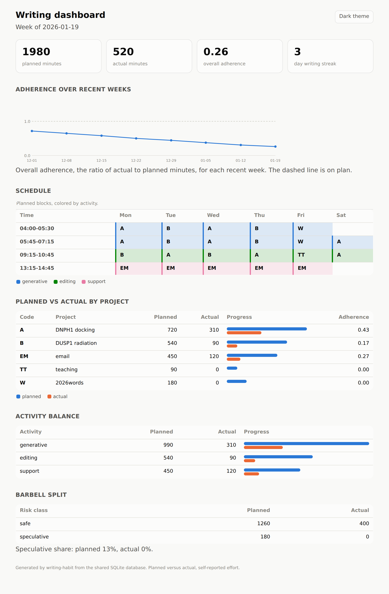
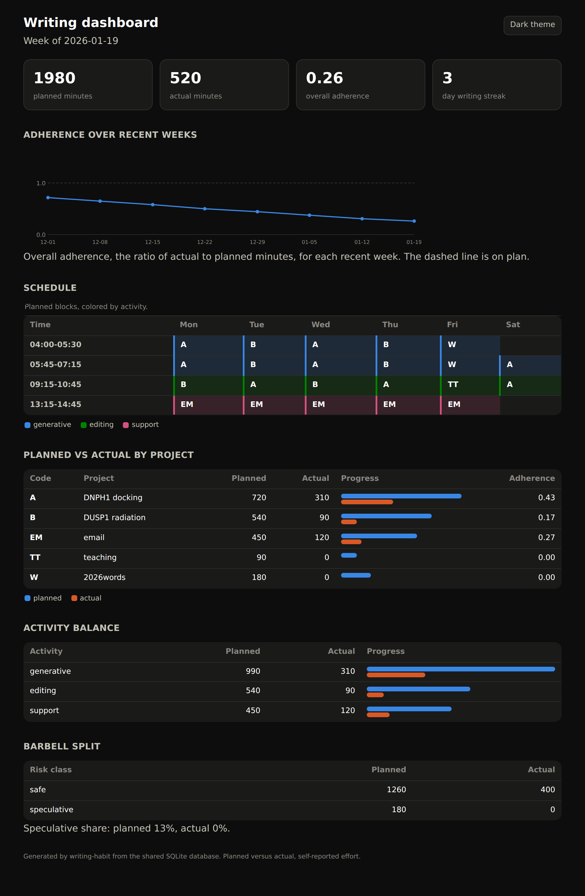

# Dashboard and reports

The compare stage turns the plan-performance gap into numbers a writer can act
on, and it presents them three ways. The plain-text report is the quickest
read. The optional bar chart is a single image. The HTML dashboard is the
fullest view, and it is the shared rendering that the Emacs Lisp twin also
produces. All three read the same four views, so they always agree.

## The four measurements

Each output is built from the same four measurements, one per view in the
[data model](data-model.md).

The per-project adherence is the actual minutes over the planned minutes for
each project, which shows where intention and effort diverged. The activity
balance is the split across generative, editing, and support, which shows
whether the week drifted away from generative writing toward easier editing or
support. The barbell split is the split across safe and speculative work, which
shows whether the speculative slot was starved. The streak is the run of days
with any writing at all, which is the visible signal to keep.

## The text report

`writing-habit compare --week DATE --db DB` prints the report. It totals the
week, breaks it down by project, by activity, and by barbell class, draws a
small text meter of actual against planned, and closes with the streak. It is
the one output that needs nothing beyond the core install.

## The optional plot

`writing-habit compare --week DATE --db DB --plot week.png` also writes a
grouped bar chart of planned against actual minutes per project. This needs the
`plot` extra, which pulls in `matplotlib`.

## The HTML dashboard

`writing-habit dashboard --week DATE --out week.html --db DB` writes a
self-contained page. It embeds its own style and script, so it opens in any
browser with no server and no network request. The page has five sections below
the summary tiles, namely a trend of overall adherence over recent weeks, the
week's schedule redrawn as a time-by-day grid colored by activity, the
planned-versus-actual comparison by project with a two-bar meter and an
adherence column, the activity balance, and the barbell split with the
speculative share.

A button in the top corner switches between a light theme and a dark theme, and
the page also honors the reader's system preference through a
`prefers-color-scheme` media query.

The colors follow a data-viz palette in which the three activities take blue,
green, and magenta, and the planned and actual marks take blue and orange,
which sit far apart for colorblind readers. Every value appears as a direct
label in ink, never by color alone, and the schedule is a labeled table, so the
page reads without relying on color.

### Personal bests and the done list

Two more sections follow the barbell split when there is something to show.

**Personal bests** appears once the database holds two or more planned weeks.
Each tile is the best week so far for one measure, namely the share of the plan
kept, the minutes written, the longest run of writing days, the objectives met,
and the mean focus over at least three reviews. A tile outlined in orange was
set in the week on the page. The bests reward the writer for beating their own
mark rather than a target they missed.

**Done this week** appears once the week has an objective or a review from the
Schedule tab. It lists the objectives you checked off, in your own words, and
then every planned block with its actual minutes, its status, its objectives
met, and its focus. A block counts as kept when the sessions of its project
that day cover at least half of it, and as partly kept below that. A missed
block is grey rather than red, because a miss is information for next week's
plan, not a verdict. Blocks later than today read as still ahead.

Both sections carry their own small style block. A database with no reviews and
a single week, such as the shared fixture, renders the same bytes as before, so
the guard against the Emacs Lisp twin below still holds. The twin does not draw
these two sections yet.

### Risky prospecting

A third section follows the barbell split when the week has risky prospecting.
This is tracked work on a writing project that is on neither the week's legend
nor the semester lists, which track sync labels when it copies the session from
`mytime.db`. These are usually prospecting efforts, and they carry a high risk
of being abandoned for lack of time, so the dashboard counts them on their own.

The section opens with the total minutes and their share of all the week's
tracked writing. A table lists each project with its sessions, its minutes, its
share, and the number of weeks it has been prospected so far. A project
prospected for three weeks or more is drawn in orange, because it has gone
unplanned long enough to call for a decision. Add it to a semester list and
give it a block, or let it go.

Prospecting is left out of the planned-versus-actual table, the activity
balance, the overall adherence, and the trend, because there is no plan to
measure it against. The barbell split gains a "risky prospecting" row with zero
planned minutes, and a line gives the risky share of actual time when the
prospecting is counted with the speculative work. The streak still counts a day
of prospecting as a day of writing. The text report from `writing-habit compare`
carries the same section.

The section and the barbell row appear only when the week has prospecting, so
the shared fixture renders the same bytes as before. The Emacs Lisp twin draws
them too. A second frozen render, `tests/fixtures/prospect.html`, made from
`tests/fixtures/prospect.db` by `scripts/make_prospect_fixture.py`, holds both
ports to the same bytes for this section. Copy both files into the twin's
`test/fixtures` whenever you rebuild them.

## The seasons dashboard

A second dashboard groups adherence across many weeks rather than within one.
`writing-habit seasons --out seasons.html --db DB` writes a self-contained page
with three tables: adherence by calendar month for seasonal trends, adherence by
event-context tag, and adherence by the schedule file-name code so plan shapes
can be compared. Tag a week with `writing-habit context set --week DATE --tag
teaching`, and the schedule code is captured at plan import from the table file
name. The page reuses the weekly dashboard's style, so the two read as one, and
the Emacs Lisp twin renders it byte for byte from the same database.

## Why the dashboard and the report can disagree by a point

The text report and the dashboard round a percentage differently, so the
speculative share can read as 12 percent in the text report and 13 percent on
the dashboard for the same week. The dashboard rounds half up, so a share of
12.5 percent becomes 13, and it does this to stay byte-identical to the Emacs
Lisp twin. Both figures describe the same underlying minutes, so the one-point
gap is a rounding choice rather than a disagreement about the data.

## Byte-identical to the Emacs Lisp twin

The dashboard markup is built deterministically from the shared database, and
the static style and script blocks are the same text both ports carry, so the
Python package and the Emacs Lisp twin render one identical file from the same
data. A frozen render is committed at `tests/fixtures/dashboard.html`, and both
test suites assert against it from the shared `tests/fixtures/cross-port.db`, so
neither port can drift into a dialect of its own.
