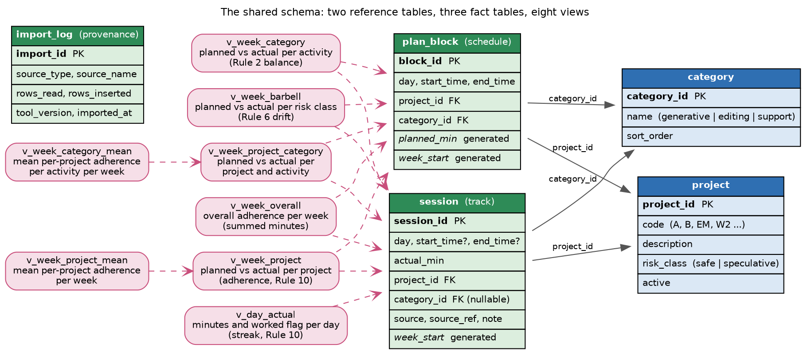

# The shared data model

The database is the single contract between the three modules, so the schema
is the place to look when you want to know exactly what the toolkit stores. The
whole schema is one file, `schema.sql`, and it is applied at `initdb`. Any tool
that reads and writes this schema can stand in for a module, which is how the
Python package and the Emacs Lisp twin share one database file.

The schema has two reference tables, three fact tables, and four comparison
views. The reference tables hold the things you name once, namely the three
activities and your portfolio of projects. The fact tables hold the events,
namely the planned blocks, the worked sessions, and a log of every import. The
views turn those facts into the four numbers the compare module reports, so the
compare module never writes its own aggregation SQL.

## Conventions

Dates are ISO 8601 text in the form `YYYY-MM-DD`. Times are 24-hour `HH:MM`,
zero padded. Durations are integer minutes. The Monday of a week is computed for
you as a generated column named `week_start`, so an importer never calculates
it. Generated columns need SQLite 3.31 or newer, and foreign keys are enabled
per connection.

## The reference tables

The `category` table holds the three writing activities, namely generative,
editing, and support, seeded once at `initdb`. A check constraint limits the
name to those three values, because the activity split depends on a fixed set.

The `project` table is your portfolio, one row per legend code such as `A`,
`B`, or `EM`. Each project carries an optional description and an optional
`risk_class` of safe or speculative, which is what the barbell view groups on.
Support is an activity category, not a risk class, so a support project carries
no `risk_class`. A project row is created by plan import when it first sees a code,
and a tracker can also create one, so a later plan import backfills the
description and the risk class when they were previously empty.

## The fact tables

The `plan_block` table holds the planned blocks written by the schedule module,
one row per block per day. It stores the day, the start and end times, the
project, and the activity. Two columns are generated. `planned_min` is the
block length in minutes, computed from the two times. `week_start` is the ISO
Monday of the block's day. A unique constraint on the day, the start time, and
the project keeps a re-import from duplicating a block.

The `session` table holds the actual sessions written by the track module. It
stores the day, the actual minutes, the project, and an optional activity. The
start and end times may be empty, because the paper-then-transcribe path enters
only a duration. A `source` column records where the session came from, one of
`ics`, `csv`, `manual`, or `sqlite`, and a `source_ref` records the row or the
calendar UID so a re-import can be traced. A `prospecting` flag is 1 when
`track sync` found the session's project in the time tracker but on neither the
week's legend nor the semester lists. Such a session is risky prospecting, and
the plan comparisons leave it out. A database made before the flag gains the
column, with every older session marked 0, the first time it is opened for
writing.

The `import_log` table records the provenance of every import, namely what was
read, how many rows were read and inserted, and when. It exists for
reproducibility, because a private study is only as trustworthy as its record
of what went in.

## One rule about the activity of a session

A session may be recorded without an activity, for example a quick duration
entered by hand. Such a session is counted in the project view and the barbell
view because its project is known, and it is left out of the activity view
because its activity is unknown. Give a session an activity whenever the split
across the three activities matters to you.

## The five comparison views

The compare module reads these five views and nothing else, so the schema stays
the single source of truth for every total.

| View | What it returns | What it feeds |
|------|-----------------|---------------|
| `v_week_project` | planned and actual minutes and an adherence ratio, per week and project | the per-project adherence, the Rule 10 signal |
| `v_week_category` | planned and actual minutes, per week and activity | the Rule 2 balance across the three activities |
| `v_week_barbell` | planned and actual minutes, per week and risk class | the Rule 6 drift, whether the speculative slot was starved |
| `v_day_actual` | actual minutes and a worked flag, per day | the streak of consecutive writing days |
| `v_week_prospecting` | sessions, actual minutes, and the weeks so far, per week and unlisted project | the risky-prospecting section of the dashboard and the report |

The project, activity, and overall views count only sessions with
`prospecting = 0`, because work on a project that is on no list has no plan to
adhere to. `v_day_actual` counts every session, so a day of prospecting still
keeps the streak alive.

The adherence ratio in `v_week_project` is the actual minutes over the planned
minutes, rounded to two places, and it is null when nothing was planned. The
streak is counted from `v_day_actual` as the run of consecutive worked days
ending at the latest worked day.
