# The graphical interface

`writing-habit-gui` is a point-and-click front end for this package and for its
companion `writing-schedule`. It edits the weekly block table, and it runs every
subcommand of both programs through a form rather than a typed line.

The interface adds no behaviour of its own. Every form is generated by reading
the same `argparse` parser the command line uses, every run calls the same
`main` function, and the command that will run is shown above the run button, so
the interface teaches the command line rather than replacing it.

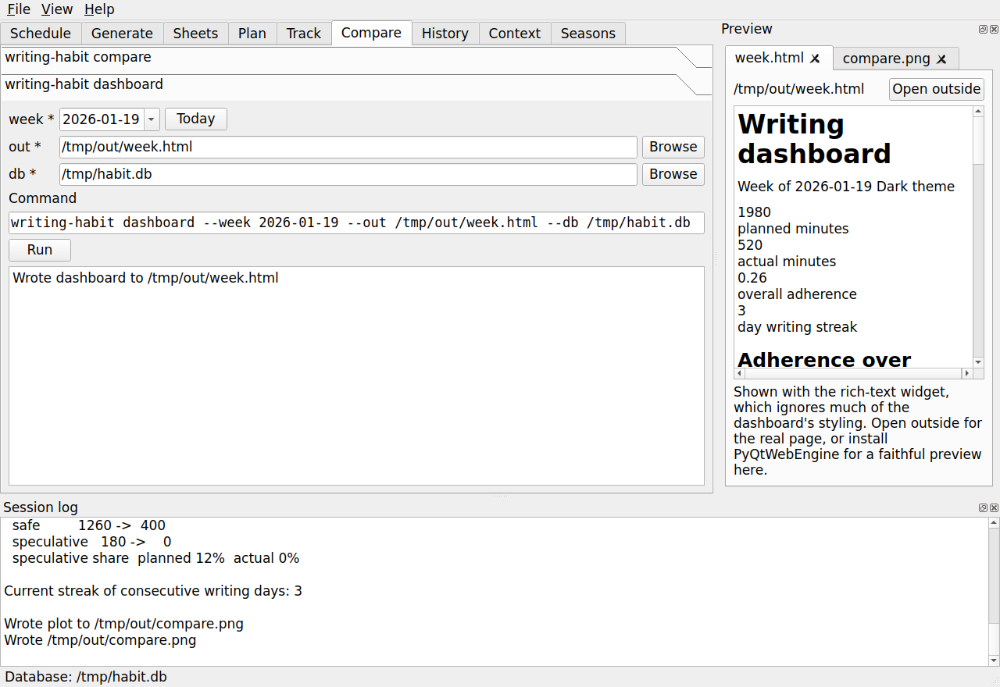

## Installing it

The graphical layer is an optional extra, so the library and the command line
stay free of a Qt dependency.

```
pip install 'writing-habit[gui]'
```

The extra installs PyQt5 and `writing-schedule`. **PyQt5 is distributed under
the GPL**, while the library and the command line remain MIT, so installing this
extra brings GPL terms with it. An installation without the extra is unaffected.

One further extra is optional even here:

```
pip install 'writing-habit[preview]'
```

That adds `PyQtWebEngine`, which renders the two HTML dashboards faithfully in
the preview dock. Without it the dock shows them with the rich-text widget of
Qt, which ignores much of their styling, and every preview offers **Open
outside** to open the real page in your browser. The web engine is a large
dependency for a convenience, so it is deliberately not part of `gui`.

Start the interface with:

```
writing-habit-gui
```

If PyQt5 is missing, the command prints one line naming the extra to install
rather than a traceback.

## The window

The tabs follow the weekly loop, from editing the table through generating the
schedule to comparing the week you planned with the week you had.

| Tab | What it holds | Program |
|-----|---------------|---------|
| Schedule | the weekly table editor, and the `template` and `check` forms | `writing-schedule` |
| Generate | `generate`, `export`, and `weeks` | `writing-schedule` |
| Sheets | `sheets` | `writing-schedule` |
| Plan | `initdb` and `plan import` | `writing-habit` |
| Track | `track import` and `track add` | `writing-habit` |
| Compare | `compare` and `dashboard` | `writing-habit` |
| History | `history` | `writing-habit` |
| Context | `context set`, `clear`, and `list` | `writing-habit` |
| Seasons | `seasons` and `name` | `writing-habit` |

Two docks sit below and beside the tabs. The **session log** records every
command that ran and everything it printed, so you can copy a line and paste it
into a terminal. The **preview** dock appears the first time a command writes a
file. Both are toggled from the View menu.

The status bar names the database the last command used, so a run against the
wrong file is visible at once. Its right end holds three buttons.
**Documentation** opens this page in your web browser, **README** opens the
README of the repository on GitHub, and **Quit** closes the window. The Help
menu offers the same two pages. When `writing-schedule` is not installed, the
status bar says so and the three scheduler tabs explain how to add it.

## Running a command

Each form carries one widget per option, chosen from the option itself. A flag
becomes a check box, a choice becomes a drop-down, a date becomes a calendar
field with a **Today** button, and a path becomes a line edit with a chooser. An
optional date, time, or count carries a small **send** box that decides whether
the option is passed at all, because those widgets always show a value.

The **Command** line above the run button shows exactly what will run. The run
button stays disabled while a required value is missing, and the reason is named
beside it. Output appears in the pane below and in the session log.

Every form keeps its own `--db` widget, matching the command line, where `--db`
is required on each subcommand that touches the database. The path you last used
seeds every form, so a weekly loop of `plan import`, `compare`, and `dashboard`
needs no retyping.

## Editing the weekly table

The Schedule tab shows the table as you laid it out. Rows are the section
headers and the time blocks in file order, and columns are the days named by the
header row, so a six-day table and a seven-day table both work.

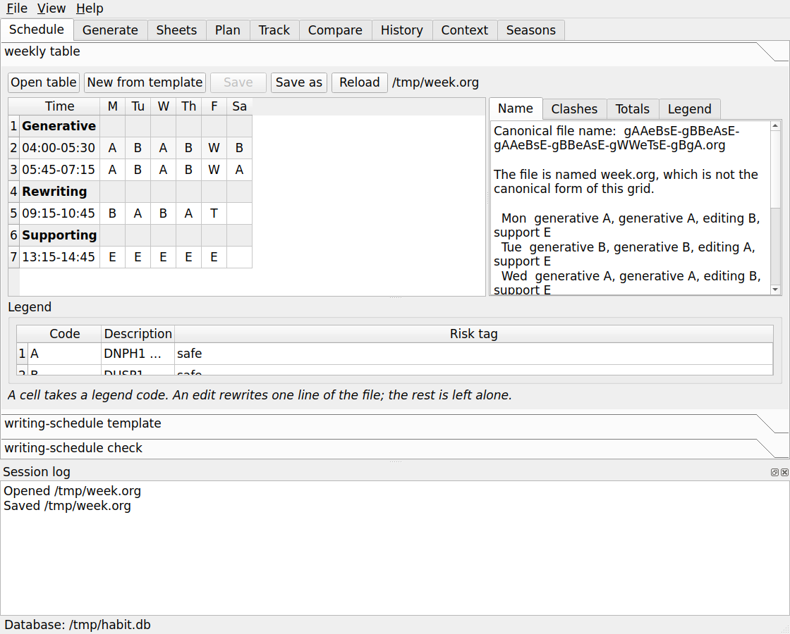

A cell takes a project code from a drop-down of the legend codes. The box is
editable, so you can type a new code, and the legend gains a blank row for it at
once. Three small buttons, **g**, **e**, and **s**, sit to the left of the box
and set the activity of the block, as described in
[Choosing the activity of each block](#choosing-the-activity-of-each-block). Section rows and the time column refuse edits, because they belong to the
file rather than to the week. Clicking a time does something else, which
[Finding the times that do not overlap](#finding-the-times-that-do-not-overlap)
describes. The legend table below the grid edits the code, the project name, the
deadline, the risk tag, which is one of `none`, `safe`, and `risky`, and the
default activity, which is one of `none`, `generative`, `editing`, and `support`.
The deadline is a date written `YYYY-MM-DD`, or empty. It is stored after the
project name in the file, as in `Z: 1008ToolsForQCrOfRNA 2026-10-05 :safe:`, so
the scheduler and the Emacs port still read the row as before. Five buttons above
the legend insert a project, move the selected one, or delete it, as described
below. A project code is a single letter or, once A to Z are taken, two letters
such as `AB`, so the legend can hold more than 26 projects. The single
digits `0` to `9` are codes too, offered after `Z` and before `AA`, and a cell
such as `g3` sets the activity of project 3. The 36 one-character codes, the
letters and the digits, are the ones a table's file name can carry.

Rows that start at the same time share one shade, and the shade alternates
between white and light gray from one start time to the next, so the choices
for a slot, such as 06:15-06:45, 06:15-07:15, and 06:15-08:15, read as a set.

**Every edit rewrites one line of the file.** A value that fits its column keeps
the table aligned; a longer value widens its own slot and leaves the rest alone,
so you realign in Emacs with `C-c C-c` when you want to. A table you open and do
not change saves byte for byte.

Six panels report on the week as you edit it.

| Panel | What it answers |
|-------|-----------------|
| Name | the canonical file name for this grid, the week its code decodes to, and whether the file on disk is named differently |
| Clashes | the overlapping blocks, with the count in the tab label and the offending cells tinted |
| Totals | planned minutes by day, by project, and by activity, any section header that maps to no activity, and any block that has no activity at all and so counts as generative |
| Legend | every project letter resolved against the legend, unused legend entries, codes defined twice, risk tags that name no class, cells whose activity letter overrides their section, and the default activities |
| Breaks | runs of blocks longer than two hours with no 15-minute break, described below |
| Energy | your best hours for each kind of writing, and the blocks that do not fit them, described below |

The toolbar holds **Open table**, **New from template**, which asks for a
project count and the shape of the day and calls the scheduler's own scaffold, **Save**, **Save as**,
which offers the canonical name, **Rename to canonical**, **Reload**,
**Open in editor**, **Insert above**, **Insert below**, **Move up**,
**Move down**, **Delete row**, and **More**, whose menu holds
**Move activities into cells**. The last seven are described below. The file name at the end of the toolbar shrinks when the
window is narrow, and its tooltip gives the full path.

Renaming is worth its button. The tracker groups weeks by the schedule code
captured at plan import, and that code comes from the file name, so a table
whose name has drifted from its grid is filed under the wrong plan shape and the
seasons dashboard then groups it with the wrong weeks. The button offers itself
only when the file is saved and misnamed, and it refuses to overwrite a
different file.

A week has no canonical name when a cell holds a project code of more than one
letter, because a file name gives one letter to one block. The Name panel says
which code is at fault, and the naming rules answer it with a single-letter
alias kept beside the full code in the legend. Everything else reads a
two-letter code whole: the scheduler, the plan importer, the totals, the
tooltips, and the legend check. A legend with more than 26 projects is
therefore fine, and only a week whose cells use the two-letter codes loses its
file name.

### Inserting a time block

Select any cell of a time-block row or a section header and press
**Insert above** or **Insert below**. Both buttons stay disabled until a cell is
selected. A dialog asks for the time range of the new block. It starts with a
block of the same length placed flush against the selected one, so a block
inserted below 05:45-07:15 is offered as 07:15-08:45. Beside a section header
the nearest block of the neighbouring section serves as the model. Edit the
range or accept it.

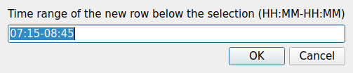

The new row is empty and selected, so you can type project codes into it at
once. It copies the column widths of the row beside it, and it copies how that
row pads its time, so a table whose Time column is padded on the left stays
that way. Saving adds exactly one line to the file.

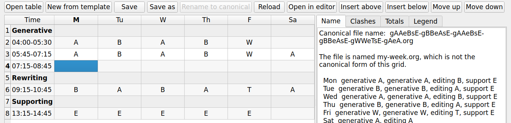

The section a row belongs to follows from where it lands, which is how the
scheduler reads the file.

| Where you insert | The new block belongs to |
|------------------|--------------------------|
| above or below a time block | that block's section |
| below a section header | that header's section |
| above a section header | the section before the header |

A range that cannot be read, or one that ends before it starts, is refused with
a message and nothing changes. The time of a row cannot be edited in the grid,
so fix a wrong time in your own editor, as described under
[Opening the table in your own editor](#opening-the-table-in-your-own-editor).

### Moving a time block up or down

Select any cell of a time-block row and press **Move up** or **Move down**. The
same moves are on the keyboard as Alt+Up and Alt+Down while the grid has the
focus, which mirrors `M-<up>` and `M-<down>` on an org table in Emacs. The row
trades places with the grid row beside it and stays selected in the same
column, so pressing the button again keeps moving the same block. Its times and
project codes travel with it unchanged, and the yellow tint, when it is shown,
follows the row.

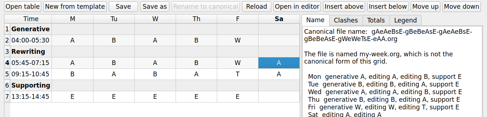

A section header is a grid row too, so a block can move from one section into
the next. The section decides the activity the block counts toward in the
Totals panel and in the tracker, and the log says so when a move changes it,
for example `Moved the 05:45-07:15 block down into Rewriting`.

| What the block passes | Where it lands |
|-----------------------|----------------|
| another time block | the same section, one row higher or lower |
| the header of the section below | the top of that section |
| the header of its own section | the bottom of the section above |

A block cannot move above the first section header, because a row there belongs
to no section, and it cannot move past the top or the bottom of the grid.
Section headers and legend rows do not move. The buttons turn grey in each of
these cases, so their state tells you what a press would do.

The line is moved in the file, not rewritten. A move inside one section swaps
two lines of the saved file, and a move up undoes a move down byte for byte.

### Deleting a time block

**Delete row**, to the right of **Move down**, deletes the selected time block.
It is enabled only while a cell of a time block is selected. A section header
is never deleted, because the blocks under it would silently join the section
above and change the activity they count toward.

A row that still holds project codes asks before it goes and lists the codes,
because the window has no undo short of **Reload**. An empty row goes at once.
The selection moves to the grid row that took its place, in the same column, or
to the row above when the last row went.

The line is removed and every other line is left untouched, so the saved file
is one line shorter and otherwise the same. The legend keeps every entry the
writer typed. A blank entry that the legend added by itself for a code typed
into a cell is dropped once no cell uses the code, as it is when the cell is
cleared.

### Choosing the activity of each block

Every block counts toward one writing activity, and the tracker measures
adherence by activity as well as by project. The activity of a block comes from
the first of these that is present.

| Source | Written as | Example |
|--------|------------|---------|
| A letter in the cell | lowercase `g`, `e`, or `s` before the code | `eA` is editing on A |
| The project's default | a tag in the legend description | `E: email @support` |
| The section header | a header row above the block | `Rewriting:` |
| Nothing at all | | counted as generative |

A letter counts only when it is a lowercase `g`, `e`, or `s` followed by a
capital, so a cell typed all in lowercase, such as `ga`, is still the code
`GA`. The scheduler applies the same rule, so the calendar, the dated schedule,
and the plan importer agree with the grid.

In the cell editor, press **g**, **e**, or **s** to write that letter before
the code, and press the same button again to clear it. A letter typed into the
box wins over the buttons. Each filled cell is tinted by its activity, pale blue
for generative, pale green for editing, and pale lilac for support. A clash
still shows red and the clear-of-selection tint still shows yellow. The tooltip
adds a line such as `Activity: editing (from the cell)`.

The **Default activity** column of the legend sets the second rule, so a project
such as email can count as support wherever it appears without a letter in
every cell. Editing the description keeps the tag, and choosing `none` removes
it. The dialog of **Insert project above** and **Insert project below** asks for
it too.

Letters in the cells make section rows optional. **More**, then
**Move activities into cells**, writes each section's letter into the bare cells
under it. A cell that already has a letter keeps it, and a cell whose project
has a default activity stays bare, because the default still applies. The
command then offers to delete the section rows. Every block keeps its activity
either way, and the canonical name does not change.

**New from template** asks for the shape of the day after the project count.
The standard day has nine blocks in three sections. The three starter days have
one block of each activity, in the order that suits the writer.

| Starter day | Blocks, in the order of the day |
|-------------|----------------------------------|
| Morning writer | generative 05:30-07:30, editing 09:00-10:30, support 13:00-14:00 |
| Evening writer | support 12:15-13:00, editing 17:30-19:00, generative 21:00-23:30 |
| Split day | generative 06:00-07:30, support 12:30-13:15, editing 19:30-21:00 |

### Finding the times that do not overlap

Click a cell in the Time column. Every row whose time range does not overlap
the selected one turns yellow, across all sections at once. This shows where
else in the day a block could go without a clash, which the grid cannot show on
its own because the blocks of different sections share one clock.

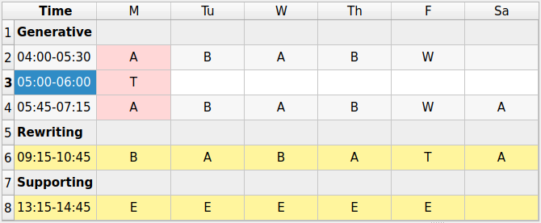

The rule is the one the Clashes panel and the scheduler use. Each range runs
from its start up to, but not including, its end, so blocks that only touch,
such as 04:00-05:30 and 05:30-07:00, do not overlap. A range whose end is not
after its start runs past midnight. The selected row itself is never tinted.

A day cell that is red for a clash stays red inside a yellow row, because the
clash is the more urgent thing to see. Clicking a day cell or a section header
removes the tint, and so does opening another table. Hovering over a yellow
time says that it does not overlap the selected one.

### The hour view and the range picker

**Hour view**, the first button of the bar, folds the table into 24 rows, one
per hour, with the days as columns. Press it again for the row view. The hour
view is the default, and the window remembers which view you used last.

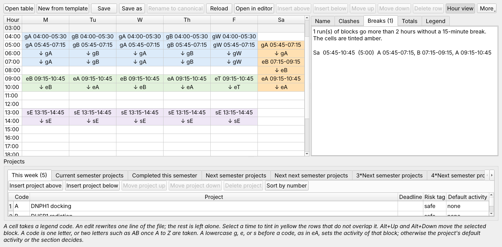

A cell lists the blocks that start in that hour, such as `gB 04:00-06:00`. The
hours a longer block runs into show `↓ gB` in the same colour, so a block reads
as one bar down the column. The activity colours, the red clash tint, and the
tooltips are the same as in the row view. Hours before and after the hours the
printed sheet draws are grey.

Double-click a cell, or press Enter on it, to open the range picker for that
day and hour.

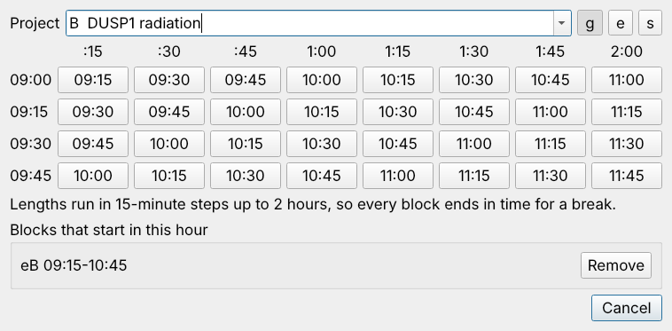

Choose the project, check the activity if the project's default is not the one
you want, and click one end time. The rows of the grid are the four starts in
the hour, and the columns are the lengths from 15 minutes to two hours in
15-minute steps. One click places the block and closes the picker. The range
you used last for a project is the default button, so a repeated block is the
Enter key. A range that would run past midnight is greyed out. The blocks that
already start in the hour are listed below the grid with a **Remove** button
each.

The table file keeps its format. A block goes into the row for its exact range,
and when the file has no such row the editor adds one in start-time order. The
picker always writes the activity letter, as in `eB`, so a new row under a
section header keeps the activity you chose. Removing a block empties its cell
and keeps its row.

### Shifting a block earlier or later

The second bar of the Schedule tab shifts the selected block in time. Select a
block in either view, then press **Earlier 1 h**, **Earlier 15 min**,
**Later 15 min**, or **Later 1 h**. In the hour view, Alt+Up and Alt+Down shift
by 15 minutes, and Alt+Shift+Up and Alt+Shift+Down shift by an hour. The
selection follows the block, so pressing the button again keeps moving it. In
an hour that a longer block runs into, the shift moves that longer block.

A block keeps its length and its activity. When it moves under a different
section header, its activity letter is written into the cell, so a shift never
changes what the block counts as. A shift that would start before midnight or
end after it is refused, and the reason appears in the log.

**Push later blocks down** decides what happens when the moved block lands on
a later one. With the box checked, which is the default, a block that starts at
or after the moved block and overlaps it moves down to start where the moved
block ends. The block after it moves on the same terms, and the chain stops at
the first block that is already clear, so a gap you left later in the day
stays. A block that starts earlier never moves, so shifting a block up into an
earlier one leaves a red clash for you to settle. With the box unchecked,
nothing else moves and an overlap shows as a clash.

The range picker carries the same box. Suppose a block is planned at 04:00 and
you place a two-hour block at 03:00. With the box checked, the 04:00 block moves
to 05:00 instead of being deleted, and any block it then overlaps moves too.

Each move empties the old cell and keeps its row, as Remove does. A range the
file lacks gets its own row in start-time order. **More > Drop unused time
rows** clears away the empty rows that a day of shifting leaves.

### The block timer

The button on the right of the second bar counts down the block under way, as
in `A 05:00-06:30, 42 min left`. It turns orange in the last five minutes. For
fifteen minutes after a block ends it reads `A block ended. Review it`, and
pressing it opens that block's objectives and review. Between blocks it names
the next block of the day and how soon it starts, and pressing it selects that
block in the grid. It rereads the clock every fifteen seconds, counts only the
week of the open table, and never sounds an alarm.

### The Pomodoro timer

The Pomodoro timer sits just right of the block timer. It splits a block into
Pomodoros of focused work with short breaks between them and ends the cycle
with a long break. The display reads `Pomodoro 1/3  18:13` during work, tinted
red, and `Short break  04:10` during a break, tinted green. Press the display
or the play button to start or pause, press the square to stop, and press
`...` for the settings.

To the right, `Today: 3` counts the Pomodoros finished today. A Pomodoro
counts when its time runs out. A break does not count, and neither does a
Pomodoro you stop early. The count is kept with the other preferences, so it
survives closing the application, and it starts over at midnight.

At 11:59 PM the timer writes the day's total to a table in a SQLite
database, by default the table `zzPomCount` in
`~/6003TimeTracking/cb/mytime.db`. The table has one row per day:

| Column | Holds |
|--------|-------|
| `date` | the day, as `2026-10-21` |
| `pom_count` | the Pomodoros finished that day |
| `recorded_at` | when the row was last written |

The table is created when it is missing. A day written twice keeps one row
with the later total. When the application is closed at 11:59 PM, or the
computer is asleep, the missed day is written the next time the application
starts, or when the next day's first Pomodoro finishes. The same catch-up
corrects the row when a Pomodoro finishes in the last minute of the day. The
folder must exist, so a mistyped folder is reported in the log and does not
create a new database somewhere else.

The Database tab of the settings sets the folder, the database file, and the
table, and turns the record off. "Record today now" writes today's count at
once, to check the settings.

By default the number of Pomodoros in the cycle comes from the block. That is
the block under way, or the block selected in the grid when none is under way.
The timer fits as many Pomodoros as the block holds with their short breaks.
With the default 25 and 5 minutes, a two-hour block holds four
(4 x 25 + 3 x 5 = 115 minutes), 90 minutes holds three, an hour holds two, and
anything shorter holds one. The long break then falls in the break between two
blocks. With no block, the cycle has four.

When a cycle ends inside a block and "Start next timer automatically" is on,
the next cycle starts by itself, with its length taken from that block.

The settings have five tabs.

| Tab | Holds |
|-----|-------|
| General | Ticking during a Pomodoro, ticking in breaks too, the tick volume with a Test button, and the tick sound file |
| Timing | Pomodoro, short break, and long break minutes; Pomodoros per cycle, or "From the time block"; "Start next timer automatically" |
| Notifications | The buzzer at the end of a phase, its volume, the alarm sound file, and bouncing the Dock icon |
| Hotkeys | Start Pomodoro, by default Control Command P, and Stop Pomodoro, by default Control Command S. Click a box and press the keys to record a new one |
| Database | Whether to record each day's total at 11:59 PM, and the folder, database file, and table it goes to |

The hotkeys work on every tab of the window while the application is in front.
They do not reach the application when another program is in front. The sounds
play through QtMultimedia. When it cannot load, the timer uses `afplay` on
macOS, and elsewhere the buzzer becomes the system beep and the tick is
silent. The settings are kept with the other preferences.

The tick and the alarm can be your own sound files. Set them in "Tick sound"
on the General tab and "Alarm sound" on the Notifications tab, with Browse to
pick a file and Built-in to go back to the built-in sound. A WAV file plays
through QtMultimedia. An AIFF, MP3, M4A, or CAF file plays through `afplay`,
so those types need a Mac. The Test buttons play the file shown in the box,
before OK saves it. When a chosen file has been moved or deleted, the timer
plays the built-in sound and says so once in the log. Keep a tick shorter
than a second, because it plays every second. The alarm sounds at the end of
every Pomodoro and every break.

### Objectives and review for a block

A planned block answers when you meant to write. Two small records answer what
the block was for and how it went. Both live in the habit database named in the
Plan and Track forms, keyed by the block's day, start time, and project code.
Track sync writes only to the session table, so rerunning it never touches
them, and when you shift a block its objectives and review move with it.

The picker shows them on its right for every block that starts in, or runs
into, the hour you opened. **Objectives and review** on the second bar opens
the same panel for the selected block on its own.

**Objectives for this block** holds one to three things the block is for, such
as "Draft the second aim paragraph". Type one and press Enter or **Add**. Check
an objective off when you meet it. Double-click one to reword it. The panel
warns above three, because a long list turns a good session into a failed one.
Objectives are saved as soon as they change, because they are the plan.

**Review when the block ends** takes about thirty seconds.

| Field | What to enter |
|-------|---------------|
| Objectives met | Filled from the checked objectives. Typed by hand for a block with none. |
| Focus, 1 to 5 | How absorbed you stayed, from 1 (scattered) to 5 (absorbed). |
| Interruptions | A tally. **+1** counts one. |
| Output | Optional, such as 600 words, figure 2, or three papers read. |
| Next step | One sentence on where to start next time. |
| Note | Anything else. |

**Save review** writes the review. Closing the picker or the dialog saves a
changed review too. The next block of the same project shows your last next
step at the top of the panel, so the session starts warm.

When the week has no date, the panel says so. A file named for its Monday, such
as `Oct12.org`, gives the date directly. A file renamed to its canonical name
takes the week that plan import filed it under in the database.

### Finding a project

The **Find** box above the project tabs filters every tab at once. Type part of
a project's name or task, or its code. A query that equals a code, such as `x`,
also matches that code. Each tab title then shows its matches, as
**This week (1 of 9)**, and the cells of the matching legend projects are
tinted blue and bold in the grid, in both the hour and the row view. A clash
keeps its red tint.

Press Ctrl+F to reach the box from anywhere on the Schedule tab. On a Mac,
Command+F and Control+F both work. Enter or the **Find next** button goes to
the next tab with a match and selects it, and Esc clears the box. With the box
empty, **Find next** puts the cursor in it. Rows are hidden, not removed, so every button
still acts on the row it shows.

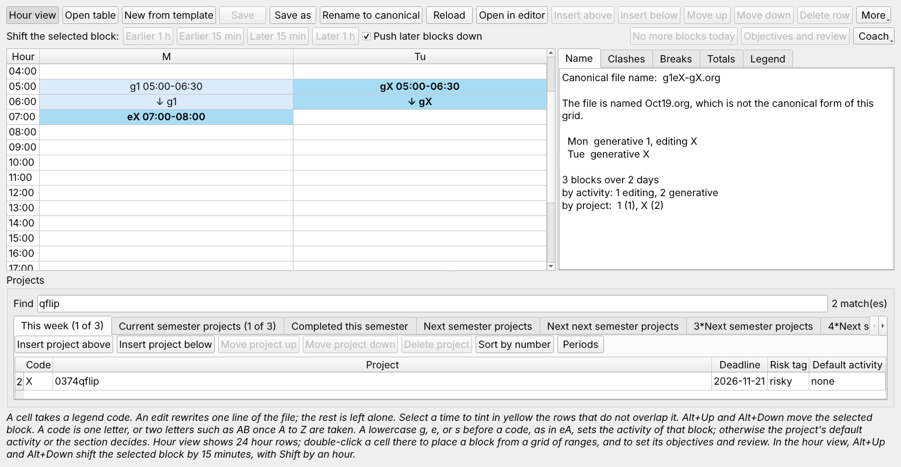

### The grasscatcher list

The **Grasscatcher** tab, after the semester lists, holds the tasks that did not
make a block's objectives. Capture everything there, then commit a few items to
each block. Each row is a task, with the code of its project in the Code column
when it has one.

```org
#+NAME: grasscatcher
| A: find three citations for the rigor section |
| - tidy the bib file |
```

Select a block in the grid, select a task, and press **Commit to this block**
to make the task an objective of that block. The task leaves the list. In the
review panel, **From grasscatcher** offers the same tasks with the block's own
project first, and **Back to grasscatcher** returns an objective to the list.
The list lives in the weekly table file beside the semester lists, so it
travels to next week's file with them. The scheduler reads only the first table
of the file and never sees it.

### Priority cookies and syncing with a project's log

A task may start with an org-mode priority cookie: a letter (`[#A]`), a number
(`[#1]`), or a letter and a number (`[#A1]`). **Sort by priority** orders the
list as `[#A]`, `[#A1]`, `[#A2]`, `[#B]`, then numbers alone, then tasks with no
cookie, keeping the order of tasks with the same cookie.

```org
#+NAME: grasscatcher
| 1: [#A1] Read the key review articles on covalent docking. |
| 1: [#B2] Run GNINA with the covalent option |
```

**Sync to-dos** compares the grasscatcher with the to-dos of each project in
this week's legend. The to-dos live under a top-level `* Project TODOS` heading
of the project's log file:

```org
* Project TODOS

** TODO [#A1] Read the key review articles on covalent docking.
** DONE [#B] Measure the cysteine distances in 7JU6
```

The log is found from the project's name in the legend. A legend entry
`1: 0142RETKinaseCovalentInhibitors` reads `~/0142RETKinaseCovalentInhibitors/log0142.org`.
When no folder has exactly that name, a single folder whose name starts with
`0142` and holds `log0142.org` is used. Several such folders are listed rather
than guessed between. The setting `projects_root` moves the search from the
home folder to another folder.

Tasks are matched by their text, ignoring the cookie, capital letters, and a
final full stop. The sync shows every change before it makes any:

| Found | What happens |
|-------|--------------|
| An open to-do in the log, not on the grasscatcher | Added to the grasscatcher with the project's code |
| A grasscatcher task not in the log | Added to the end of the log's Project TODOS as `** TODO` |
| A grasscatcher task the log marks DONE or CANCELED | Taken off the grasscatcher |
| The same task with different cookies | The log's cookie wins |

Open keywords are TODO, NEXT, STARTED, WAITING, and HOLD. Headings at any depth
under Project TODOS count, and org tags at the end of a heading are ignored. A
log is changed only by new lines at the end of its Project TODOS section, and a
copy of the old file is kept beside it with `~` added, as Emacs does. The
grasscatcher reaches the weekly file when you save the table.

If the log is open in Emacs, its lock or autosave file shows, and the preview
says so. Run `M-x revert-buffer` in that buffer after the sync, or the next save
from Emacs would drop the new to-dos.

![The grasscatcher after Sync to-dos, with the log's [#A1] task added.](imgs/gui-todo-sync.png)

### The coach

The coach is an optional helper for five of the Ten Simple Rules. It drafts a
block's objectives and ranks the grasscatcher (Rule 4), writes a debrief after
a block (Rule 5), reads patterns across weeks and sizes the week's plan
(Rule 7), and drafts the weekly summary for an accountability partner (Rule 8). It never writes your manuscript, and every task has a plain answer
written without a model, so nothing depends on it.

| Where | Button | What it does |
|-------|--------|--------------|
| Review panel | **Suggest** | Type a vague task in the objective box, such as "work on the R01", and press Suggest. The coach drafts one to three objectives and an if-then plan for the likely distraction. Check the ones to keep. They are added with the origin `ai`, and the if-then plan goes into the note. |
| Review panel | **Debrief** | A short note on the block. It leads with what you finished, names one obstacle at most, and suggests a first step for next time. It is saved with the review. |
| Grasscatcher tab | **Rank** | Orders the tasks by the nearest deadlines and this week's planned projects, with a reason for each. **Use this order** rewrites the list. |
| Coach menu | **Read my weeks** | The two strongest patterns in how you keep your plan, by weekday, schedule shape, event tag, and month, and one change to try. |
| Coach menu | **Size this week's plan** | A plan size for the open week, the median of what you actually wrote in up to eight recent planned weeks, or in earlier weeks with the same schedule code or event tag. |
| Coach menu | **Check deadline coverage** | The projects due in the next 28 days with no block left this week, and a block to give each one. See [Deadline coverage](#deadline-coverage). |
| Coach menu | **Match blocks to my energy** | The blocks whose hours do not suit their kind of writing, by your energy profile, and swaps that fix them. See [The Energy tab](#the-energy-tab). |
| Coach menu | **Summary for my partner** | A short message about the open week for an accountability partner, written as you. Edit it and press **Copy to clipboard**, then paste it into an email or a chat. Nothing is sent for you. |

The software computes every number before the model sees it, and the model only
puts the numbers into words. A pattern needs at least four weeks behind it. A
sentence from the model that carries a number the facts do not hold is replaced
by the plain sentence, and a plan-size note keeps the computed number however
the model words it. Each dialog has **Show what was sent**, which lists the
exact facts that left the database.

**The partner summary.** Rule 8 suggests trading the week's plan on Monday and
the comparison on Friday with a partner, and sharing summaries rather than
details. The summary holds the minutes planned and written, the share of the
plan kept, the blocks kept, kept in part, and still ahead, the objectives met
against those committed, up to three of the objectives you met in your own
words, and next week's planned minutes when that plan is in the database. It
mentions up to two personal bests from the week once there are two planned
weeks to compare, and it notes a return to the plan after a planned week with
no writing. It never names an unmet objective, a focus rating, or a note.

| Paragraph | What it says |
|-----------|--------------|
| The time | Minutes planned and written, the share kept, and the blocks |
| The work | The objectives met of those committed, and up to three of them quoted |
| The rest | A return to the plan, personal bests, and next week's planned time |

A model's draft is used only when it states the share of the plan kept and
carries no number that the facts do not hold. Otherwise the plain summary is
shown with the reason. The summary needs no model, so it is offered even in an
AI-off week and during a block. In those cases the plain summary is shown and
nothing is written to `ai_log`, so the week still counts as a week without the
coach.

**The local model.** Open **Coach > Settings...** to choose the server, its
address, and the model. The model picker lists the models the server has
installed, from Ollama's `/api/tags` or an OpenAI-style server's `/v1/models`,
and **Refresh** asks again. A name can also be typed for a model you are about
to pull. Check **Use the local model** there, or **Coach > Use the local
model**, or **Ask the local model** in the review panel, which are one setting. The coach then asks a
model served on your own computer. The settings are `ai_model` (`llama3.2` by
default), `ai_url` (`http://localhost:11434`), and `ai_api`, which is `ollama`
for Ollama or `openai` for the OpenAI-style interface of LM Studio, llama.cpp,
and Ollama. An address that is not on this computer is refused unless
`ai_allow_remote` is `true`. When the model does not answer, the coach falls
back to the plain answer and says why. The request runs on a worker thread, so
the window stays usable while the model thinks.

**The guardrails of Rule 10.**

- The coach stays silent during deep work. If the clock is inside a planned
  block of the open week, it asks before answering.
- **Coach > AI off this week** silences the coach for the calendar week, so
  you can check that the habit holds without it.
- Every request is written to the `ai_log` table with the facts sent, the
  reply, who wrote it, and whether you accepted it. Once two or more weeks with
  the coach and two or more without it have plans, the weekly dashboard
  compares their adherence. The note says plainly that a few weeks describe
  your record and do not prove the coach helped.
- The coach reads only what you typed or imported. It never reads the screen,
  other apps, or your manuscript files.

To try it, install Ollama, run `ollama pull llama3.2`, and check **Use the
local model**. To compare models before choosing one, run
`python scripts/try_coach_prompts.py llama3.2 qwen2.5:7b --out coach-trial.org`
on the same computer. The script sends fixed sample facts, never your records,
and writes an org report of each model's replies with a verdict on each.

The prompts live in `src/writing_habit/coach_prompts.json`. The Emacs Lisp twin
reads its own copy of the same file in `writing-habit-coach.el`, so the two
ports give the same advice.

### Deadline coverage

A full week can still leave out the project whose deadline is nearest.
**Coach > Check deadline coverage** finds every project with a deadline in the
next 28 days, from the legend and from the semester lists, and checks how much
of this week's remaining plan goes to it. A block counts as remaining from
today on. The setting `coverage_days` changes the 28 days.

For each project due soon with no block left this week, the check proposes one
block to give it. The block comes from a project with no deadline in that span,
keeps its time and its activity, and is still ahead this week. Generative and
editing blocks are offered before support blocks, a project with no deadline
gives before one with a later deadline, and a project with more time ahead
gives first. A project with a deadline always keeps at least one block, and a
project due soon never gives one up. When every block ahead belongs to a
project due soon, the check says so and proposes nothing.

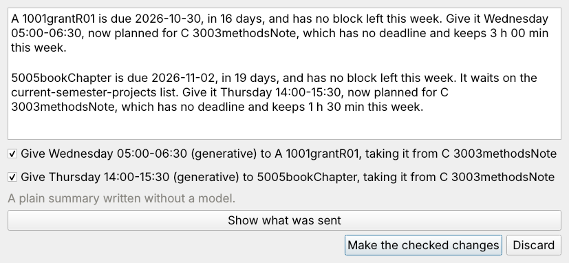

Check the proposals to keep and press **Make the checked changes**. A project
that waits on a list, such as the book chapter, is first copied into the
week's legend with a free code. The file changes only when you save. The
check is made by the software, so it works without the habit database, without
a model, in an AI-off week, and during a block. With the local model on, the
model only words the note, and a note with a number the plan does not hold is
replaced by the plain note.

### The Energy tab

Rule 2 of the Ten Simple Rules paper says to put generative work in the hours
when you think best. The **Energy** tab beside the Legend panel records your
energy for each kind of writing, hour by hour, as High, Medium, or Low. Click a
cell to step it through the three levels. The profile is kept with your other
preferences.

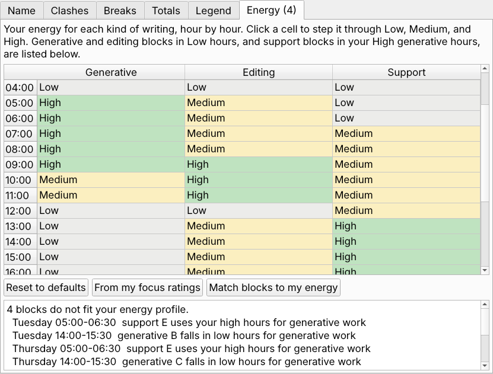

The default profile follows a common pattern. Mornings are High for generative
writing, late mornings are High for editing, and the early afternoon is High
for support tasks. **Reset to defaults** restores it. **From my focus ratings**
proposes a profile from your own reviews, setting an hour from the mean focus
of the blocks of one activity reviewed in it. A mean of 4 or more is High, 3 or
more is Medium, and lower is Low. An hour changes only when it has at least
three rated blocks of that activity, and you check the changes to keep.

The list under the grid names two kinds of block that do not fit, and the tab
title counts them, as in **Energy (4)**.

| Block | Why it does not fit |
|-------|---------------------|
| Generative or editing | Its hours are mostly Low for that activity |
| Support | Its hours are mostly High for generative work, so email takes your best writing time |

**Match blocks to my energy**, on the tab or in the Coach menu, proposes swaps.
A swap exchanges the work of two blocks of the same length on the same day, so
every project keeps its minutes and its day. A swap is proposed only when it
makes the week fit better, each block takes part in one swap at most, and a
day that has passed is never changed. The objectives of a swapped block move
with their project. As with deadline coverage, the swaps come from the
software, and a model only words the note.

### The two-hour break rule

The **Breaks** panel lists every run of blocks on one day that lasts more than
two hours with no gap of at least 15 minutes. Blocks that touch or overlap join
a run, and so do blocks separated by less than 15 minutes. The cells of each
run are tinted amber in both views, and a clash keeps its red tint. The rule is
a warning, and a table with a long run still saves.

### Dropping unused time rows

**More > Drop unused time rows** deletes every time-block row whose day cells
are all empty, after asking. Section headers, the legend, the filled rows, and
the canonical name stay as they were. A copy of the file on disk is kept with
`.bak` added, and nothing else is written until you save.

The printed sheets do not change. The `sheets` command draws every hour from
the start hour to the end hour as a ruled grid and draws only the filled cells
as boxes, so the blank space for pen work is there whatever rows the table
holds.

### Inserting a project into the legend

Two buttons above the legend table, **Insert project above** and
**Insert project below**, add a project beside the selected entry. They are
enabled as soon as a table is open. With no entry selected, a project inserted
below goes to the end of the legend and one inserted above goes to the start.

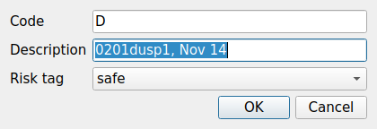

The dialog asks for three things.

Code
: A capital letter followed by up to three capitals or digits. The field starts
  with the first code that neither the legend nor the grid uses yet. The single
  letters come first, and once A to Z are taken the field offers `AA`, `AB`,
  and so on to `ZZ`, which makes room for 702 projects. **New from template**
  accepts the same range and adds the two-letter entries after `Z:`.

Project
: The project name, such as `0201dusp1`. Begin it with the project's
  four-digit number, because `track sync` matches time-tracker rows to the
  legend by that number.

Deadline
: A date written `YYYY-MM-DD`, or empty. Any other text is ignored, and the log
  says so.

Risk tag
: One of `none`, `safe`, and `risky`.

A lowercase code is raised to capitals. A code the legend already defines is
refused, because the readers keep the first definition of a code and silently
drop the second. The new entry is selected on its description, and its code
appears at once in the drop-down of every grid cell.

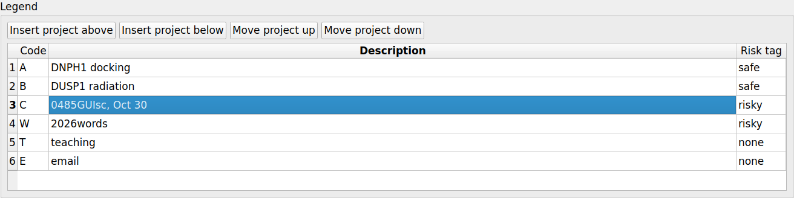

A project you insert stays in the legend even before any cell uses it. The
legend removes only the blank rows it added by itself, for a code you typed into
a cell and then deleted, so a typo leaves nothing behind. A blank project read
from the file is kept too. A blank entry is written as `C:`, which both this
editor and the scheduler read as a legend row rather than as a section header.

### Moving a project up or down in the legend

Two more buttons above the legend table, **Move project up** and
**Move project down**, shift the selected entry by one row. Alt+Up and Alt+Down
do the same while the legend has the focus. Each pair of keys belongs to its
own table, so the keys move a time block when the grid has the focus and a
project when the legend has it. The entry stays selected in the same column, so
pressing again keeps moving the same project.

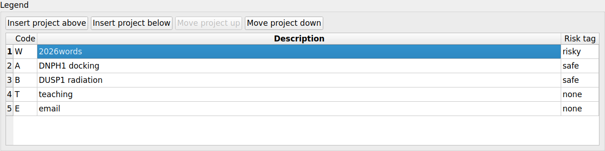

A project trades places with the legend entry beside it, so it never leaves the
legend and never passes a row of the grid. The first entry cannot move up and
the last cannot move down, and the matching button turns grey. Moving a project
changes nothing in the grid, the totals, or the canonical name.

The order is not only cosmetic. When a code is defined twice, both the editor
and the scheduler keep the first definition, so moving the second definition
above the first changes which description and risk tag the tools use. The
Legend panel lists any code defined more than once, so you can see which one
now wins.

As with a block, the line is moved rather than rewritten. A move swaps two lines
of the saved file, and a move up undoes a move down byte for byte.

### Deleting a project from the legend

**Delete project**, to the right of **Move project down**, deletes the selected
legend entry. It is enabled once an entry is selected. The selection moves to
the entry that took its place, or to the one above when the last entry went.

A project that cells of the grid still use asks first and says how many cells,
because those cells then show as not in the key, both in their tooltips and in
the Legend panel. The deletion stands until the next edit of a grid cell, which
adds back a blank entry for every code the grid still uses. Clear or retype
those cells first when the project should go for good. Deleting a project never
changes the grid, the totals, or the canonical name.

### Opening the table in your own editor

**Open in editor**, to the right of **Reload**, opens the table file in your
text editor. It is enabled once the table has been saved to a file. The editor
is named by the `WHGEDITOR` variable, which may carry arguments.

```
# in ~/.bashrc
export WHGEDITOR="emacsclient -n"
```

The button looks for the editor in this order.

| Order | Where it looks |
|-------|----------------|
| 1 | `WHGEDITOR` in the environment of the running interface |
| 2 | the last `WHGEDITOR=` line of `~/.bashrc`, with quotes, a trailing comment, and `$HOME` handled |
| 3 | the system's default text editor, which is `open -t` on macOS, `xdg-open` on Linux, and the file association on Windows |

The second step exists because a window started from the Dock or Finder has not
sourced your shell start-up file. For the same reason, a bare program name is
also looked for in `/opt/homebrew/bin`, `/usr/local/bin`, and `/opt/local/bin`,
which such a window does not have on its path. A full path always works. The
editor runs on its own, so closing the interface does not close it.

The editor reads the file on disk, so the button checks for unsaved edits
first.

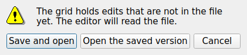

**Save and open** writes your edits and then opens the file.
**Open the saved version** leaves your edits in the grid and opens the file as
it was last saved. **Cancel** opens nothing. The session log records the command
that started the editor. After you save in the editor, press **Reload** to bring
the changes back into the grid.

## Seeing what a command wrote

The preview dock keeps one tab per recent file.

| Output | How it is shown |
|--------|-----------------|
| The weekly dashboard and the seasons page | rendered, faithfully with the `preview` extra and roughly without it |
| The `compare` and `history` plots | as the image, with its pixel size |
| The schedule `.org`, the `.ics`, and the sheet `.org` or `.tex` | as text |
| The sheet PDFs | by name, because Qt has no PDF viewer here |

Every tab offers **Open outside**, which hands the file to the program your
desktop uses. That is the honest answer for the dashboards, and the only one for
a PDF.

## Testing and troubleshooting

The graphical tests run without a display:

```
make test
```

The Makefile exports `QT_QPA_PLATFORM=offscreen` for that reason. A checkout
without the extra skips the graphical tests rather than failing them.

| Symptom | Cause and cure |
|---------|----------------|
| `writing-habit-gui` prints an install hint | PyQt5 is missing; `pip install 'writing-habit[gui]'` |
| The Generate and Sheets tabs show an install note | `writing-schedule` is missing; the `gui` extra installs it, or install a checkout in editable mode |
| A dashboard preview looks unstyled | the `preview` extra is not installed; use **Open outside**, or add `PyQtWebEngine` |
| `plan import` reports a missing package | the same `writing-schedule` dependency, reported in the output pane rather than as a traceback |
| **Open in editor** reports that the editor could not start | the program in `WHGEDITOR` is not on the path the window sees; give its full path, such as `/opt/homebrew/bin/emacsclient -n` |
| **Open in editor** opens the wrong program | `WHGEDITOR` is unset, so the system default for `.org` files opened; set `WHGEDITOR` in `~/.bashrc` |
| An edit made in your editor does not show in the grid | the grid does not watch the file; press **Reload** |
| **Insert above** and **Insert below** are greyed out | no grid cell is selected; click any cell of a time block or a section header |
| **Move up** and **Move down** are both greyed out | the selection is a section header, or no cell is selected; click a cell of a time block |
| **Move up** alone is greyed out | the block is the first row under the first section header, so it has nowhere above to go |
| Alt+Up or Alt+Down does nothing | neither the grid nor the legend has the focus; click a cell of the table you want to reorder first |
| **Move project up** and **Move project down** are both greyed out | no legend entry is selected; click any cell of a legend row |
| **Delete row** is greyed out | the selection is a section header, or no cell is selected; click a cell of a time block |
| **Delete project** is greyed out | no legend entry is selected; click any cell of a legend row |
| A cell typed as `ga` shows `GA` | a letter counts only before a capital; type `gA`, or press **g** in the cell editor |
| A block counts toward the wrong activity | its tooltip names the source; a letter in the cell beats the project's default, which beats the section |
| The Totals panel lists blocks counted as generative | those blocks have no letter, no project default, and no section above them |
| **New from template** offers no starter days | writing-schedule is older than 0.4; upgrade it |
| A deleted project comes back as a blank entry | a cell of the grid still uses its code, and a grid edit restored the entry; clear those cells and delete it again |
| **Hour view** is greyed out | no table is open |
| **Insert above**, **Move up**, and **Delete row** are greyed out in the hour view | they act on a file row; press **Hour view** again for the row view |
| A picker button is greyed out | that range would run past midnight |
| A cell is amber | the block is part of a run of more than two hours with no 15-minute break; see the Breaks panel |
| The picker added a row to the file | the file had no row for that exact range; the row is placed in start-time order |
| The project tabs read Current semester projects | there is no `periods.org` beside the table, or the date falls outside it; press **Periods** |
| The tabs name the wrong semester | the file name's date or today's date is outside the period you meant; check the dates in **Periods** |
| A banner asks which period the lists are for | the file has no `#+PROJECT_PERIOD:` line; choose the period and press **File under this period** |
| **Roll forward** is offered too early | the new period starts sooner than you want; move its Start date in **Periods** |
| **Sync to-dos** says no log file found | the project's folder is not named like the legend entry and no folder starts with its number; check `projects_root` |
| **Sync to-dos** lists several logs | more than one folder starts with the project's number; rename the legend entry to match the folder name |
| New to-dos vanished from a log | Emacs had the log open and saved its old buffer; recover them from `logNNNN.org~` and revert the buffer before the next sync |
| A tab shows (0 of 12) | the Find box still holds text; press Esc in it |
| A blue note says the file was read with changes | the file used another layout; save to write it in the standard one |
| The This week tab holds every project of the semester | the file is in the older layout; use **More > Move extra legend blocks into the lists** |
| The Name panel says the week has no canonical name | a cell holds a two-letter code such as `AB`; the file name allows only single letters, so give the project a letter or keep the current name |

## Licensing

The library, the command line, and this documentation are under the MIT license.
The `gui` extra installs PyQt5, and the `preview` extra installs PyQtWebEngine,
both of which are distributed under the GPL. Installing either extra therefore
brings GPL terms into your environment. The About dialog of the interface states
the same split.

### Splitting old legend descriptions into project and deadline

Legends written before the Deadline column held free text, such as
`B: 1006AIrxOpt, NSF Dec 15 :safe:`. **More > Split legend into project and
deadline** rewrites each such entry as a project name and a `YYYY-MM-DD`
deadline. A dialog first lists every change. Its details show, for each entry,
the project, the deadline, and any text that would be dropped, such as `NSF` or
`submitted October 5`. Nothing reaches the file until you save.

The rules are these. The project is every project directory name in the text,
such as `1008ToolsForQCrOfRNA`, joined by a comma when there are two. The
deadline is the last date in the text. A date led by `submitted` or `sent` is
a record rather than a deadline and is not used. A month and day with no year
take the year of the week in use, unless that is more than about two months in
the past, when they take the next year, so `March 1` written in October means
next March. Risk tags and default activities are kept.

## The Tutorials tab

The last tab holds one tutorial per task of the weekly loop, each in its own
subtab: Start here, Edit the schedule, Import the plan, Import writing effort,
Compare plan and effort, Dashboard, Longer view, Calendar and sheets, and
Troubleshooting. Each page gives the point-and-click route and the matching
commands, with screenshots of the practice week in `examples/tutorial`. A link
such as **Track** on a page raises that tab, and **Help > Tutorials** opens the
tab from anywhere.

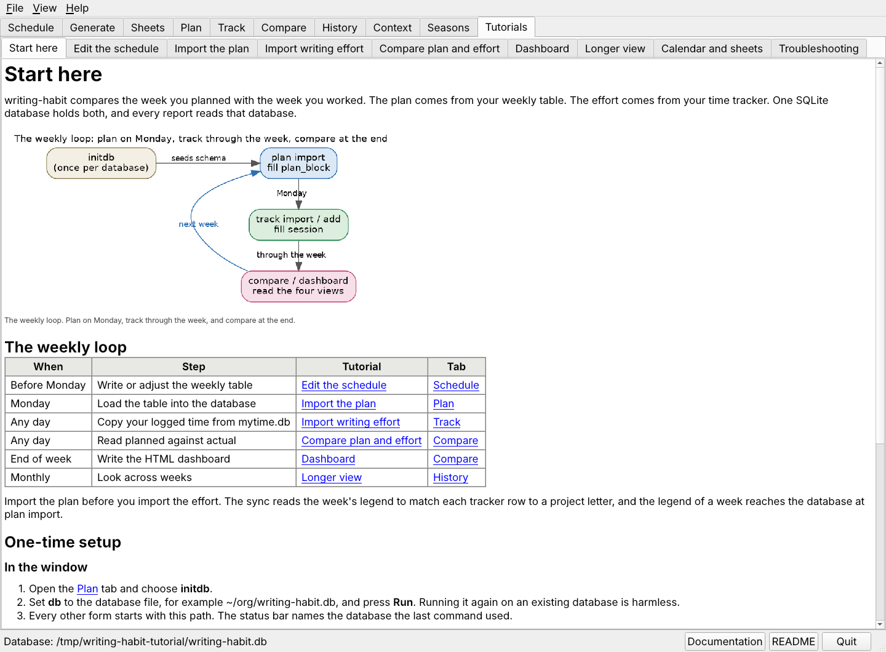

The pages and their images ship inside the package, so the tab needs no network.
After a change to the window, regenerate the screenshots from the real program:

```
QT_QPA_PLATFORM=offscreen PYTHONPATH=src python scripts/make_tutorial_images.py
```

## Semester project lists

The box under the grid, titled **Projects**, holds ten tabs, and an eleventh
after a roll forward, each showing its
number of projects in parentheses. **This week** is the week's legend, which
should name only the projects of the week. **Current
semester projects**, **Completed this semester**, **Next semester projects**, **Next next semester
projects**, **3*Next semester projects**, **4*Next semester projects**,
**5*Next semester projects**, and **6*Next semester projects** hold the longer
lists, six semesters or about two years ahead, with the same columns as the legend.
**Sort by number**, on every tab, orders the projects by the four-digit number
that starts each name, with unnumbered projects last. Each
list has buttons to add, move, and delete a project, and **Copy to this week's
legend** brings the selected project into the week, keeping its code when the
legend does not use it yet. A project with no code yet has an empty Code cell. On the current list, **Mark completed** moves the selected project to the end
of **Completed this semester**, and never adds it there twice.

In the file each list is its own small table after the weekly table, named by
an org line, with rows in the legend's form and a dash for a missing code:

```
#+NAME: current-semester-projects
| B: 1006AIrxOpt 2026-12-15 :safe: |
| - 1002RNAeditingR01 2027-02-05 :safe: |
```

The scheduler reads only the first table of the file, so the lists never reach
plan import, the calendar, or the sheets. `track sync` reads the current list,
and **New from template** carries the lists into the new week.


### Project tables in columns

The legend and the project lists may be kept as tables with one column per
field, the same columns the window shows:

```org
#+NAME: This week
| Code | Project Number | Project Name    | Deadline   | Risk tag | Default activity |
|------+----------------+-----------------+------------+----------+------------------|
| B:   | 1006           | AIrxOpt         | 2026-12-15 | :safe:   |                  |
| -    | 1452           | PHFSboXt        | 2027-03-01 | :safe:   | editing          |

#+NAME: current-semester-projects
#+CAPTION: Fall 2026 projects
| Code | Project Number | Project Name | Deadline | Risk tag | Default activity |
...

#+NAME: grasscatcher
#+CAPTION: Grasscatcher
| Code | Project Number | Project Name                | Priority | Task          |
|------+----------------+-----------------------------+----------+---------------|
| 1:   | 0142           | RETKinaseCovalentInhibitors | [#A1]    | Read reviews. |
```

A file in this layout is written back in it. The legend stays in the `This
week` table after the time blocks, and each list keeps its standard name with
its tab title as the caption, so the name does not change when a new semester
starts while the caption does. A dash in the Code column means the project has
no code yet. The Default activity column takes generative, editing, or support.
A grasscatcher row names its project by code, and the editor fills in the
project's number and name from the legend or the lists when it saves.

An untouched file saves byte for byte. The scheduler (writing-schedule 0.6 or
newer), plan import, `track sync`, and the sheets read the `This week` table
when the first table has no legend rows. The Emacs port does not read the
column layout yet.

### Files in other layouts

The editor reads three other layouts and brings each to the standard one. A
blue note above the project tabs lists what it changed, and the file on disk
is not touched until you save.

| The file has | What the editor does |
|--------------|----------------------|
| The legend in its own table, named `#+NAME: This week`, after the time blocks | Moves its rows under the time blocks, where the scheduler, plan import, and the sheets read the legend |
| Lists named by their tab titles, such as `#+NAME: Fall 2026 projects` or `#+NAME: 3*Next semester projects` | Gives each its standard name, such as `current-semester-projects`, using the calendar for the period names |
| One list named twice | Merges the second table into the first, keeping each project once |

A file in the older layout kept the semester lists inside the legend, one
block after another with a rule between them, so every project read as a
project of the week. The note says so, and **More > Move extra legend blocks
into the lists** keeps the first block as the week's legend and moves the next
blocks to the current, next, and later semester lists, after showing the moves.

The standard names stay relative to the current period, so a file keeps
meaning the same thing after a roll forward. The tab titles are only how the
window shows them.

### Naming the lists by semester, quarter, or fiscal year

The **Periods** button, beside **Sort by number** on the This week tab, edits a
calendar of named periods. With a calendar, the tabs read **Fall 2026
projects**, **Completed in Fall 2026**, **Spring 2027 projects**, and so on, in
place of Current semester projects and 3*Next semester projects. Each tab's
tooltip gives the period's dates and the list's name in the file. Without a
calendar, or past its last period, a tab keeps its plain title.

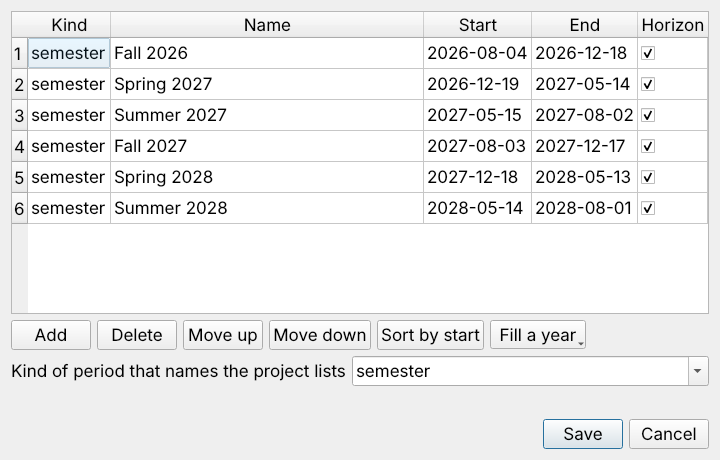

The calendar is an org table in `periods.org`, beside the weekly tables, so it
can be edited in Emacs as well:

```
#+NAME: periods
| Kind     | Name        | Start      | End        | Horizon |
|----------+-------------+------------+------------+---------|
| semester | Fall 2026   | 2026-08-04 | 2026-12-18 | yes     |
| semester | Spring 2027 | 2026-12-19 | 2027-05-14 | yes     |
| semester | Summer 2027 | 2027-05-15 | 2027-08-02 | yes     |
```

Kind is any word that groups periods, such as semester, quarter, trimester, or
fiscal. **Kind of period that names the project lists** chooses which kind the
tabs use. A period whose Horizon box is cleared keeps its name but is not a
planning step, which suits a summer you do not plan. **Fill a year** adds
starter rows for semesters, academic quarters, trimesters, calendar quarters,
or a fiscal year that starts in a chosen month. The starter periods are
contiguous, so the break before a term counts toward that term. The dialog
lists overlapping periods, backward dates, repeated names, and long gaps before
it saves.

The date that decides the current period is the Monday in the file name, such
as `Oct12.org`, or today when the name carries no date.

### Rolling the lists forward to a new period

The weekly file records the period its lists belong to in one line before the
first list, such as `#+PROJECT_PERIOD: Fall 2026`. A file without that line
shows a banner that asks which period the lists are for, with **File under this
period**.

When the week falls in a later period, the banner offers **Roll forward to
Spring 2027**. The titles keep the old period's names until you roll.

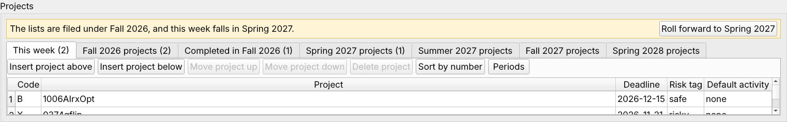

A roll asks first and then:

| List | What happens |
|------|--------------|
| Completed | Appended to `completed.org`, beside `periods.org`, under a heading for the period, then emptied |
| Current | Moved to **Carried over** for review |
| Each later list | Moves one period nearer |
| The farthest list | Left empty for the newest period |

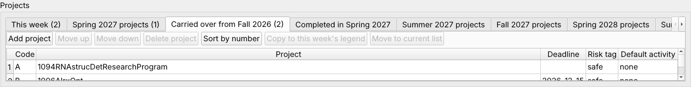

On **Carried over**, **Move to current list** keeps a project and **Delete
project** drops it. The tab hides itself once it is empty. `track sync` counts
time on carried projects until you decide. A roll across several periods, after
a long leave, moves the lists one step per period. The weekly grid and the
legend do not change, and the file is written when you save.

